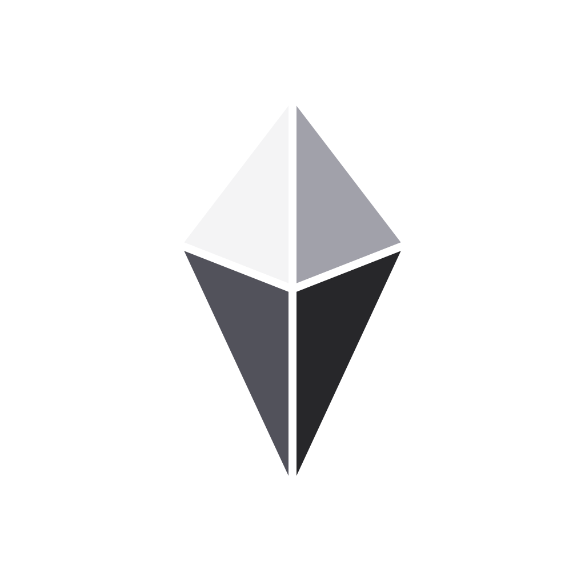

# Atlas

Atlas is a personal AI that feels like Jarvis. You talk to one character by voice or text. It knows your life, sees what's happening around you, does real work, deals with other people for you, and keeps going while you're away.

It's open source and self-deployed with one click to Cloudflare.

> **Status: M1 closed, M2 next (2026-10-22).** M0, the voice and core prototype, passed its smoke test on the owner's Cloudflare account. M1, the companion (memory and recall, compaction, helpers, areas, the character, the UI v1 shell, passkeys and setup), is closed with its calendar steps carried forward while iCloud refuses Atlas's sign-in; [docs/M1.md](docs/M1.md) has its smoke test, findings and decisions. M2, follow-through, starts from [docs/HANDOFF-M2.md](docs/HANDOFF-M2.md).

## Read this first

| | |
|---|---|
| [VISION.md](VISION.md) | What Atlas is, why it's a fresh start, and how every part works: the core loop, memory, areas, faces, helpers, voice, approvals, automations, the vault, brains, the Cloudflare platform, the UI, setup, and the build order. |
| [docs/ui/](docs/ui/README.md) | UI v1, locked Oct 21, 2026. It has the shell, the six places, screenshots of every screen, the visual language, and the source files. |
| [docs/M0.md](docs/M0.md) | The first milestone: deploy, benchmark, the smoke test and what it found, and the decisions made while building. |
| [docs/HANDOFF-M1.md](docs/HANDOFF-M1.md) | Where things stand after M0, how we work (smoke tests in place of a week of use), open issues, and the M1 plan. |
| [docs/M1.md](docs/M1.md) | The second milestone: the smoke test, what's built, deploying over M0, and the decisions made while building. |
| [docs/HANDOFF-M2.md](docs/HANDOFF-M2.md) | Where things stand after M1, what's still open, and the M2 plan. |
| [docs/CHARACTER.md](docs/CHARACTER.md) | Atlas's character, and the eval that checks every brain against it. |
| [brand/](brand/) | The diamond mark and app icons. |

Old Atlas is kept for reference at [atlas-legacy](https://github.com/maxjb-xyz/atlas-legacy). Ideas carry over from it, code doesn't.
