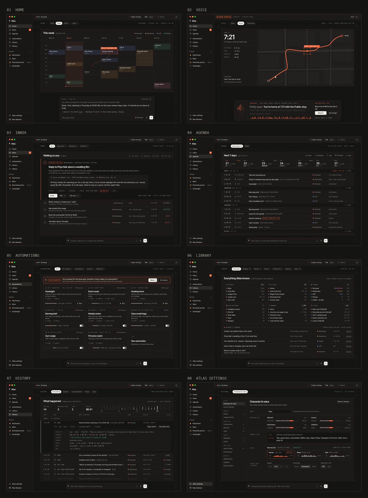

# Atlas: vision and architecture

**Date:** 2026-10-21.
**Status:** the agreed direction from the owner's planning conversation. Nothing here is built yet. This is the founding brief for the rebuild. Old Atlas is kept for reference in [atlas-legacy](https://github.com/maxjb-xyz/atlas-legacy). Open items are in §26.

Every later plan, spec and handoff must agree with this doc, or change it in its own reviewed commit.

## 0. How to read this

- §1 to 3: what Atlas is, why we're starting over, and the build rules.
- §4 to 20: the design, one part per section.
- §21 and 22: the UI and setup. The UI v1 screens are in [docs/ui/](docs/ui/README.md).
- §23 to 26: everything else, what carries over, build order, open questions.

---

## 1. What Atlas is

Atlas is a personal AI that feels like Jarvis. You talk to one character by voice or text. It knows your life, sees what's happening around you, does real work, deals with other people for you, and keeps going while you're away. It's useful for personal life, work and fun.

It's open source and self-deployed with one click to Cloudflare, like Hermes and OpenClaw are self-hosted. Version 1 is built for the owner first, but every part is designed for anyone.

**The test.** After a month, would you text it first when something happens? And does it text you first with things you're glad to hear?

**Why someone picks Atlas over Hermes or OpenClaw:**
1. **It knows your world.** It keeps a real database of your people, places, commitments and projects, plus live senses: location, calendar, mail, home.
2. **You can talk to it.** Low-latency voice is the same Atlas with the same powers.
3. **It shows you things.** You get a stage of live views, not walls of text.
4. **It deals with people for you.** Faces answer, schedule and follow up, under your rules.
5. **It runs while you're away,** always on, with nothing to babysit.
6. **It has a character,** not a system prompt full of rules.
7. **What you already use carries over:** skills, MCP servers, coding agents, memory files.

## 2. Why we're starting over

Old Atlas ([atlas-legacy](https://github.com/maxjb-xyz/atlas-legacy)) grew to:
- about 310k lines of Python, plus 308k lines of tests;
- 260 database migrations and 200+ settings;
- 150 actions and about 40 background jobs.

On the 2026-10-17 audit:
- 0 of 3 real goals finished;
- 0 of 10 coding jobs succeeded;
- conversation scored 2.3 out of 5 (partly on the fallback model).

Fixes kept breaking other things. These are the causes, and this design is built to avoid each one:

1. **Behavior was enforced by code wrapped around the model.** Regex rewriters for replies, a promise checker, a claim checker, reply shaping, privacy taint, a keyword router for voice, and about 40 personality patches. Each was added after an audit finding, and they interact, so loosening one breaks another. There were 47 memory, 33 voice and 28 work fix commits in two weeks.
2. **Each idea existed several times over.** There were eight separate "what's happening now" builders, about 15 background loops and 6+ ways to message the owner. Schedules, protocols, watchers, heartbeat, missions, tasks, objectives and work were all separate concepts.
3. **It was too big to check.** No one, human or agent, could hold it in their head, so every fix only saw part of the system. Phases shipped behind on/off flags.
4. **It grew wide before deep.** A feature counted as "built" when its tests passed, not when the owner had lived with it.
5. **The brain was fragile.** The main model ran through a local Codex process whose connection died silently and never came back. The fallback model behaved differently, which invited more guards.

Hermes feels better turn to turn because each turn is a plain loop: the model does the work, and nothing rewrites its output. Atlas keeps that loop and builds what Hermes lacks around it.

## 3. Build rules

These rules bind as firmly as the architecture does.

1. **No code rewrites or second-guesses the model's output.** If Atlas behaves wrongly, fix the character, the context, a tool's description, or the tool itself. Never add a filter.
2. **Safety lives at the exits, not inside the turn.** The exits are wherever data leaves, money moves, other people are touched, or something can't be undone (§12, §14, §15).
3. **One of everything.** One loop, one log, one clock, one way out. A new mechanism has to replace an existing one.
4. **The core stays small enough to check.** Each new mechanism replaces an old one where it can (rule 3), and each milestone's close reports the core runtime's size, not counting UI and extensions, with what grew and why. (Changed 2026-10-23: this replaced a 25k-line cap. Atlas needs room to grow, as Hermes and OpenClaw did; what the cap guarded against, a core no one can hold in their head (§2, cause 3), is watched by one of everything and the size report instead.)
5. **No behavior flags.** Settings exist for people. Flags that switch between two implementations of the same behavior are not allowed.
6. **Everything has a screen.** Every concept can be seen, changed and undone in the app. Talking to Atlas is a shortcut, never the only way. After the one-click deploy, nothing needs a terminal.
7. **Done means it works on the real deployment.** A milestone is done when its smoke test passes on the owner's real deployment: a short list of day-in-the-life checks, run by hand, that covers every surface and failure path the milestone adds. Green tests are required but not enough. The owner keeps living with each milestone while the next one is built, and anything that feels wrong becomes a fix. (Changed 2026-10-21, after M0: a smoke test replaced a week of use, so milestones aren't held up waiting.)
8. **Use standards instead of inventing.** SKILL.md, MCP and MCP Apps, ACP, OAuth, open formats. Invent only where no standard exists.
9. **Wrong guesses should be cheap.** Anything Atlas infers (areas, tags, importance) only changes convenience. Anything with consequences is an explicit setting.
10. **Rule of cool, with taste.** Atlas should feel like the future: fast, alive, beautiful. Motion and look are part of the product, held to a performance budget (§21.8).

**House style** for docs and UI copy: plain sentences, sentence case, no em dashes, and they/them for anyone whose pronouns we don't know.

---

## 4. The core: one loop, one log, one clock, one way out

### 4.1 One loop

Every run of Atlas is the same agent loop, with the same character, memory and tools, no matter what started it:
- you typing or talking, on any surface;
- an automation that was scheduled or triggered;
- an event worth attention (§10);
- a message from another person to a face (§7);
- a helper doing delegated work (§8).

Before the model sees anything, code sets the run's **run context**:

| Field | Meaning |
|---|---|
| `actor` | Who this run is talking with: the owner, a member, a contact, or Atlas itself |
| `on_behalf_of` | Whose interests and data this run serves |
| `trigger` | What started it: a message, voice, an automation ID, an event ID, or the parent of a helper |
| `surface` | App, voice, phone, SMS, email, a chat app, or the API |
| `areas` | The "hat": which areas this run is acting in (§6) |
| `powers` | Which tools and records it can reach, worked out from the actor, the face and the area settings |
| `budget` | How many steps, how much time and how much money this run may use |

How the loop behaves:
- **Long step budgets,** set by kind of run. Starting points: 40 steps for chat and 150 for background work. Limits are soft time limits, not hard walls.
- **Compaction.** At about 70% of the context window, a silent "save what matters" pass runs, then older context is summarized.
- **Parallel tool calls,** and helpers for big jobs.
- **When a budget runs out,** one final answer with no tools: "Here's what I found. Want me to keep going?"
- **Long work moves to the background** on its own, survives restarts, and reports back where it was asked for. Background runs execute inside durable fibers (the Agents SDK's `runFiber`): the loop saves a checkpoint after each step and picks up from it after a restart. A chat reply that a restart cuts off simply ends as failed, with the reason.

Every run ends in exactly one final state, which is saved: replied, deferred or failed. Live streams are progress hints only. A refresh always shows the saved truth.

### 4.2 One log

Each person has one append-only event log. Every one of these is a row:
- each message, in both directions, on every surface;
- each tool call, and the receipt for its result;
- each record change;
- each automation run, approval and delivery;
- each sense event.

Each row has a time, actor, run, area tags and a privacy label.

Everything else reads from the log: the console and transcript, History, "what are you working on?", "why did you text me?", the daily journal, and the next turn's context. Nothing is ever removed from the log except by the owner (§23.4).

### 4.3 One clock: the agenda

These are all **agenda items**:
- reminders, automations and watches;
- long jobs and follow-ups;
- promises.

Each item is a row with a kind, a next-run time or a trigger, a lease, and a link to where it came from. One scheduler, built on Durable Object alarms, wakes them all. Only what has a time or a trigger is on the clock: a thing to do with no time is a task (§5.1), not an agenda item.

When Atlas says it will do something later, it creates an agenda item in the same step, and the console shows it as a receipt (§21.1). It also shows in Agenda as a promise.

### 4.4 One way out: the outbox

Everything that leaves Atlas goes through one outbox: messages to you, to members or to contacts, posts, emails and calls.

The outbox does three things:
1. **Picks the channel and the timing** (§14).
2. **Runs the exit checks:**
   - approvals (§12);
   - the secrets scrubber;
   - sharing rules (§7);
   - the public-query check, so private details never go into a web search. Private means a secret, an email address, a phone number, a street address Atlas keeps, or where you are; names, places and topics aren't, on their own (decided 2026-10-22). Places are the one exception, and only for the maps services (§19.1): a saved address or where you are can go to them for a pin, a route, travel time or what's nearby, and nowhere else. Weather gets only a rough area, about 10 km across (decided 2026-10-22, for M4).
3. **Writes a delivery receipt** into the log.

---

## 5. Records and memory

Atlas shouldn't forget. It keeps everything and gets good at finding it.

### 5.1 Three layers

1. **The log** (§4.2): permanent and raw.
2. **Records:** typed, curated knowledge.
   - **Built-in types:** person, place, organization, event, task, goal (a project is a goal), note, preference, commitment, document.
   - **A task** is anything to do: open, done or dropped, with an optional deadline and an optional **when it fits**: a kind of place ("a pharmacy"), a place ("the office"), a person ("next time I talk to Sam"), or plain words ("when the new season's out"). Errands, to-dos at work and things to try for fun are all tasks (decided 2026-10-23). A deadline puts one reminder on the clock (§4.3); the task itself stays a record. The intake (§10.4) checks open tasks against what comes in, and Agenda lists them under To do.
   - **Collections** are types Atlas creates when it needs them ("assignments", "clients", "workouts", "festival deadlines"). Atlas can add fields later, and you can create and edit collections in the app like a spreadsheet.
   - **Links** connect records: works with, part of, lives at, about.
   - **Every record carries:**
     - its source (the message, email or event, with a link);
     - when it was learned;
     - a confidence level;
     - area tags;
     - who can see it.
   - **Corrections replace the current value,** and the old value stays in history.
3. **Summaries:**
   - a daily journal and weekly roll-ups;
   - a portrait of each person Atlas serves: one overall, plus one per area. It includes their routines, usual places and rhythms, from where they go, their calendar and their mail (M7).

   All are rewritten nightly from the records and the log.

### 5.2 Always in view

Every run's context has two parts:
- **A stable block that can be cached:** the character, the portrait, and standing instructions and corrections.
- **A small fresh block:**
  - the situation (§10);
  - open commitments and questions;
  - the people in this conversation;
  - what has changed since the conversation started.

Recall fills in the rest, on demand.

### 5.3 Recall

The `recall` tool searches the way a person remembers:
- by keyword and by meaning;
- by time ("last spring");
- by links ("anything with Jordan about Riverside").

It filters by area, type and date, and results come back with their sources. Records that keep getting recalled stay near the top. Records nobody uses drift down in ranking, but they're never lost.

### 5.4 Writing

- **On purpose, during the turn.** Atlas saves things as it talks ("Noted: you're vegetarian"), and a chip shows what was saved.
- **From connections.** Quarantined helpers read incoming mail, messages and calendar changes. They use Clairic, or whatever model fills the `extract` role, to pull out typed values with a confidence level. When unsure, they return nothing. So "the dentist moved to Friday" in an email updates that event and anything that depends on it.
- **Never from Atlas's own work.** Runs started by automations, helpers or Atlas's own maintenance can't create facts about the owner. Atlas's notes about its own work go into its own records.
- **A nightly tidy-up:**
  - merges duplicates;
  - settles contradictions (the newest well-sourced value wins, and the other goes to history);
  - refreshes the summaries.

  A guard stops any nightly pass from removing more than a small fraction of anything, and every change it made is listed in History.
- **"Forget that"** works by voice, by text, and with a button on any record.

### 5.5 In the app

Library (§21.2) shows everything:
- search;
- places (people are in their own place, §21.2);
- collections as tables;
- the journal and the portrait;
- "Not sure about these": low-confidence records you confirm or reject with one tap.

Each record shows its source, history and areas, and you can edit it.

---

## 6. Areas

### 6.1 What they are

An area is an ongoing part of someone's life: a job, a business, school, family, health, money, home, a hobby. In practice, areas are labels on records, conversations and events, plus one page per area that Atlas writes.

A project is just a goal record inside an area. There's no fixed list of categories, because the model already knows what school or a business usually involves.

### 6.2 What an area changes (the "hat")

When a run acts in an area, that area's page and records come first in context, and the area's settings apply:
- **tone:** formal with clients, relaxed with friends;
- **accounts:** which email or calendar to use;
- **autonomy:** what Atlas can do without asking (§12);
- **sharing:** who else can see what Atlas produces;
- **skills:** which ones Atlas reaches for first.

An area never changes who Atlas is, the log, or the owner's access. You can ask about anything, across all your areas, at any time.

### 6.3 Staying accurate without micromanaging

- **Areas are discovered.**
  - Setup proposes areas from calendars, email domains, contacts and the first few conversations.
  - Later, when people, places and topics keep showing up together and don't fit any area, Atlas starts a new one and mentions it once.
- **Tagging is cheap.** The `decide` role (Clef by default) tags every message and event with areas and a confidence level. If it isn't sure, the item gets no area.
- **Atlas asks at most once,** and only when the answer would change what it does. The question appears as a one-tap suggestion in the app.
- **It learns from corrections.** Changing the area on anything re-tags related records. The correction also becomes a rule ("email from @keyframes.studio is Keyframes") and an example for future tagging.
- **It tidies nightly.** It suggests merges ("Gym and Running look like one thing"), splits and archiving. Quiet areas go dormant, stay searchable, and wake up when activity comes back.
- **Wrong guesses are cheap** (rule 9). Areas are lenses, not walls. Sharing, sending accounts and autonomy are explicit settings, so a wrong tag only means slightly worse context for one reply.

### 6.4 The area page

Atlas writes and keeps up the learned parts, and you can edit them:
- what the area is, and your role in it;
- people;
- current goals and projects;
- routines;
- recent activity;
- collections.

Settings are explicit and start with careful defaults: tone, accounts, autonomy, sharing, faces and automations. In the app, areas live in Library, and the settings that control what leaves Atlas are one row per area in Library → Areas (§21.3).

Shared areas, such as Home or Family, belong to several members (§7.1).

### 6.5 Skill bundles

A skill bundle packages skills, collection templates and suggested automations, for example "Freelancer: invoices and client follow-ups". Bundles are optional, install like skills, and are never needed for areas to work.

---

## 7. People and faces

### 7.1 Who Atlas serves

- **Owner:** the person who deployed it, with full control.
- **Members:** household or team members you invite in the app.
  - Each has their own relationship with Atlas: their own thread, private records, areas and voice settings.
  - They can share areas with each other.
  - Roles are owner, admin and member.
  - No one can read another member's private records, including the owner.
- **Contacts:** everyone else, meaning people Atlas knows about and may talk to on someone's behalf.
  - A contact is a person record with channels (numbers, emails, handles), and Atlas recognizes them across all of those.
  - Each has a trust level: family, friend, colleague, client or unknown.

### 7.2 Faces

A face is Atlas, reachable by people who aren't you. Each face has:
- **A name and an introduction** ("Hi, this is Atlas, Max's assistant"). It always says it's an AI.
- **Addresses.** Any of these, of its own, or it can share Atlas's main ones:
  - an email address (free on your domain);
  - a phone number (bought in the app);
  - chat handles (Telegram, Discord, WhatsApp);
  - a chat widget for a website.

  One address can serve both sides: when the owner uses it they get Atlas, and anyone else gets the face.
- **Audience:** anyone, known contacts only, or specific people or groups.
- **Covers:** which areas it works in. Usually one.
- **Shares,** per area: whether you're free or busy, public info and FAQs, project status, documents you've marked shareable, or nothing.
- **Can do:** book or hold time, take messages, answer questions, collect details into records, send files, hand off to you.
- **Pulls you in when:** something is urgent, money is involved, it can't answer, or a specific person writes.
- **Speaks as:** Atlas, by default, or as you. Speaking as you needs your OK on each message, until you allow a particular kind of message.
- **Digest:** a summary of its conversations (daily by default), with anything urgent sent right away.

The rules:
- What other people say is information, never instructions to Atlas.
- A face only sees what its areas and sharing settings allow, and it never mentions your other areas.
- Every conversation goes into the log, so asking "What did Jordan want?" just works.

**In the app,** each face has its own screen under People → Faces (§21.2), with everything above and a "talk to it as a stranger" test. Its conversations are in History (the Faces tab), and what it hands to you goes to Inbox.

---

## 8. Helpers and delegation

### 8.1 Helpers

A helper is a short-lived child agent that Atlas starts for one piece of work. It runs the same loop with a narrower brief and fewer tools, has no personality, and never talks to people directly.

Helpers are used for:
- **Keeping Atlas's context clean:** read 40 pages, hand back one table.
- **Parallel work:** compare five options at once.
- **Long jobs** that run for hours or days, survive restarts, and report back.
- **Reading untrusted content,** like an unknown email or web page. The helper can't act; it only returns structured facts.
- **Driving outside coding agents** (§8.2).

The rules:
- A helper never has more powers than the run that started it.
- Everything a helper sends goes through the outbox.
- Each helper has its own budget.
- Each returns a summary plus receipts for what it did.
- Helpers can nest at most two levels deep.
- Every helper action goes into the log.
- When a helper needs a decision, it asks Atlas. Atlas answers from what it knows, or asks you in plain words.

On Cloudflare, helpers are the Agents SDK's sub-agents (dynamic agents, with their own storage), each running Atlas's own loop inside a durable fiber, so background ones survive restarts. A helper's storage is only its scratch space: everything it does is written to the log of the agent that started it.

### 8.2 Coding jobs: Atlas as the middleman

A coding job runs whichever coding agent you choose (Claude Code, Codex, OpenCode, Gemini CLI, or others) over ACP, the Agent Client Protocol.
- **Where it runs:** always in the workspace (§9.1), the owner's own container on Cloudflare, never on a node (decided 2026-10-23, for M6). The coding agent is a process there, with the workspace's network rules: it reaches only the sites allowed, and its key is added at the gate, outside the container.
- **Repos:** from GitHub, through its extension (§17), which clones, pushes the branch and opens the pull request (decided 2026-10-23, for M6).
- **Plans:** Codex runs on your ChatGPT plan. Claude Code needs an API key or whatever Anthropic's terms allow at the time (§18).

Atlas acts as the middleman:
- it watches the job's stream;
- it answers routine questions itself, from what it knows about the project and your preferences;
- it brings you only the real decisions;
- it reviews the diff and test results, opens the PR, and reports back.

You can ask "How's the Keyframes job?" by voice from the car, or watch the live terminal in the app.

### 8.3 Jobs Atlas owns

Coding jobs were the first long work that changes things. Any long piece of work can be a job Atlas owns (decided 2026-10-24, for M7): "make the launch video", "plan the Lisbon trip", "get three quotes for the roof". The coding job's way of working is the model.
- **A job is a goal Atlas owns:** a goal record (§5.1), a plan of steps, a folder of its own in the workspace, a budget (time, steps and money), and the brain it runs on (§18).
- **It runs as short looks.** Each wake takes one step or reads how one went, then saves the job's state, so a job waits for free, survives a deploy, and can change brains between steps. It's on the one clock (§4.3).
- **Helpers do the work,** with powers scoped to the job: inside its folder they can change things, and anything that leaves Atlas goes through the outbox (§4.4) as always. A step that writes code is a coding job (§8.2). A video, for example, is a coding job on a video project plus Atlas's own voiceover.
- **Checkpoints with you.** The plan marks what needs your OK before Atlas goes on ("approve the script", "approve the cut"), and a decision only you can make comes to Inbox as one question. Atlas answers the rest itself, as the middleman does.
- **It lands as things you keep:** files and pages (§21.7), with a receipt, and the result in Inbox.
- **In the app** it's a job like any other (§21.4): its steps, what it has made so far, what it's waiting on, what it has cost, with Steer and Stop.

### 8.4 One Atlas, not many bots

Many people split their assistant into several separate bots. Atlas doesn't: you keep one relationship, and Atlas gets many hands.
- **Helpers** keep context clean.
- **Areas** handle focus and access.
- **Faces** handle other people.

Underneath, each is Atlas, writing to one log.

---

## 9. Hands, finding a way, and learning

### 9.1 Hands

- **Workspace:** a Cloudflare Sandbox for each person.
  - It has a shell, Python, Node, files and a persistent `/workspace` folder, and Atlas can install what it needs.
  - Network access is granted per website domain, approved once and remembered.
  - The app shows a live terminal and a file browser.
- **Browser:** Browser Run.
  - Its live view shows on the stage, with a "take over" button for logins and captchas.
  - Vault logins are filled in at the last step (§15).
- **Web:** search and fetch, with sources kept.
- **Code Mode:** Atlas can write one small program that calls many tools at once, run in a Dynamic Worker.
- **Narrow tools** only for accounts, people and money: calendar, mail, messages, payments, home devices.

### 9.2 Finding a way

- There are no small step limits (§4.1).
- **Persistence is part of the character.** Atlas tries another route before asking, and asks only for what only you can give: a password, a decision, money.
- **It can grow its own abilities.** When it lacks a capability, it can find and add an MCP server or skill, or write an extension (§17). Anything that touches your accounts needs your OK.
- **When it's truly stuck,** it sends one message: what it tried, and the one thing it needs.

### 9.3 Skills and learning (Hermes-style, made reliable)

Skills use the SKILL.md format, so skills from Claude Code, Codex, Hermes and OpenClaw work unchanged.

- **Learned from outcomes.** After a task that succeeded and that you accepted, Atlas drafts a skill, including what went wrong along the way.
- **Reviewed after each conversation** (decided 2026-10-24, for M7). Saving a skill mid-turn depends on Atlas remembering to, so it isn't the main way Atlas learns, as it isn't in Hermes. When a conversation goes quiet, a review runs: one of Atlas's own runs, on the clock, with only the skill tools. It reads the conversation and patches the skills that were used, or saves a new one, when there's something worth keeping: a correction ("stop doing X"), a method that took working out, or a skill that turned out wrong. "Nothing to save" is a fine outcome. It's the one kind of Atlas's own run that may write skills, and it writes only skills: facts about the owner still never come from Atlas's own work (§5.4).
- **Found again.** Every skill's one-line summary sits in the index Atlas always sees, tagged by area, with its use counted. Old Atlas wrote 14 skills of its own and reused none, because nothing ever surfaced them.
- **One skill per method.** A new skill that reads like one Atlas already has is refused with that skill's name, so Atlas patches it instead. Near-duplicates are Hermes's main known weakness.
- **Patched, not rewritten:** a change replaces the passage that was wrong, with history and undo.
- **Folders, as the standard has them.** A skill is its SKILL.md plus its folder (references, scripts, templates, assets), kept in R2. Scripts run in the workspace.
- **Tested.** A skill can include a quick check that runs in the sandbox. A weekly pass re-runs the checks and flags broken skills.
- **Tidied.** The nightly tidy-up merges duplicates, and unused skills are archived, never deleted.
- **Measured.** How often a skill Atlas saved is opened again is the number that shows the learning works, and each milestone reports it.
- **Visible.**
  - "I learned how you file reimbursements" appears in the console.
  - Abilities → Skills (§21.2) lists every skill with its history, its runs and what it can touch.
- **Installed like the rest:** from the catalog (§17), from a link, or pasted.

---

## 10. Senses, world state and awareness

### 10.1 Senses

Senses are sources that put events into the log, all through one intake (§10.4):
- location: OwnTracks first, posting to Atlas over HTTPS with its own token (a web app can't send location in the background), then the phone app (decided 2026-10-22);
- calendar changes, mail and messages;
- Home Assistant and home devices, through a home node;
- the desktop and phone apps: focus, battery, connection;
- webhooks;
- faces' conversations;
- weather and travel;
- the services you connect: Gmail, Slack, GitHub, Linear and the rest. Each is an adapter (§17) that turns what the service has into the intake's rows; a webhook source and the watch (§13.2) cover a service with no adapter yet.

### 10.2 The situation

Each person has a small, live situation record that is always in context:
- where you are, and since when;
- what you're doing, from your calendar and devices;
- what's next, and when to leave;
- travel time;
- weather that matters;
- device states.

It's rebuilt from the latest events in the intake, never guessed.

### 10.3 Awareness without the cost

Every event goes through the intake's steps (§10.4), which come down to three:
1. **Rules,** which are cheap and fixed: duplicates, quiet hours, sources you've turned off.
2. **Decide,** using the `decide` role (Clef by default). Is this worth a thought now, later or not at all? Does it matter to anything open, such as a commitment, a task, an event, a project, an automation or a person you care about? Which area is it in, and how urgent is it? This takes tens of milliseconds and costs a fraction of a cent.
3. **Atlas.** Only if step 2 says now does the main brain run, with the event and the records it touches; what can wait, it sees in a batch later. It decides whether to act, tell you, or stay quiet. What to make of an event is its own judgment, from the character and the situation, never a script per kind of event (rule 1).

**Looks on the clock** are automations, not a second mechanism (decided 2026-10-23): the morning brief and the evening wrap-up are default routines (§13.4) that report only when something is worth saying. What the clock gives the senses is **the moment before each event** (decided 2026-10-23): shortly before something on your calendar starts, or before it's time to leave for one with a place, the intake gets an item for it, with who it's with. It's weighed like any other item. It matters when something open touches it, like a task to tell Doug something when you see him, or when it's time to leave, which follows the trip's travel time as it moves with traffic and where you are.

**Example:**
1. "Left the gym" arrives from your phone.
2. It matches the open task "get oat milk", which fits at a grocery store. A task tied to a place is looked at whenever you leave somewhere or move; one tied to a person, whenever something comes in from or about them, such as an event with them coming up (matched by what Atlas knows of them: their names and addresses); others, when decide says the item fits.
3. Atlas checks your route home.
4. It sends: "There's a Publix two minutes off your way home. Still need oat milk?", on your phone or in your ear.

The gym is one example, not the design. Others like it, with nothing built for any of them: a meeting moved so it now clashes with another, traffic that means leaving earlier, rain before a walk to your next thing, a pull request waiting on your review, a reply from the landlord after a week.

**Reactions are logged** for each nudge, with what it was about in Atlas's words: replied, ignored, dismissed, "stop", "thanks". They tune what gets through, and "stop" becomes what you don't want to hear about, in your words, which you can see and change. Later, Cloudflare's fine-tuning platform could train a personal `decide` model from them.

### 10.4 One intake

Everything Atlas takes in goes through one intake, whatever its source (decided 2026-10-23). It does two separate jobs:
- **Knowing.** Every item is read, linked to what it's about (a person, a project, an event) and folded into the records and the situation. An item judged not worth attention still does all of that, so a wrong call costs attention, never information (rule 9).
- **Attending.** What Atlas thinks about now runs on changes to things that matter, not on raw items: "the dentist moved to Friday, which now clashes with the shoot", not "an email arrived".

**The shared row.** An adapter turns each raw item into a `sense` row of one shape:
- what happened, in a line;
- a key, so the same thing arriving twice, or from two sources, counts once;
- the thread or thing it belongs to: an email thread, an issue, an event;
- who it's from, and the source's own signals (assigned to you, a review requested, a newsletter), so cheap rules can use them before any model runs;
- a link back, and the raw content, kept aside and quarantined (§20).

Adapters keep a cursor (Gmail's history id, GitHub's last time), so a restart neither misses nor repeats anything. Each item moves through saved states, received, then weighed, then done or failed, and a restart picks up where it stopped.

**The steps.**
1. **Collect** (code, cheap and fixed): duplicates, sources you've turned off, and your own actions coming back to you.
2. **Read.** Structured sources (location, the calendar, devices) are read by code. Words from other people (mail, messages, a webhook's payload) are read by a quarantined helper with the `extract` role (§5.4), which returns typed facts and links, never instructions.
3. **Weigh** (`decide`): a glance at each item, ending in **now** (urgent, or it matters to something open right now), **later** (worth knowing, but it can wait) or **never** (it changes nothing for you).
4. **Fold in.** The records, the situation and the later pile change, whatever the outcome.
5. **Atlas** wakes only for now, and acts, tells you, or stays quiet (§10.3).

**Two speeds.** The glance is cheap and per item. The later pile is looked over in a batch by a run of Atlas's own, with the full picture, on the clock and by the routines that look at the day (§13.4), and the next conversation sees it too ("since you last looked"). A batch costs less than waking for each item, and judges better than a small model deciding each one alone.

**Open loops.** Silence can be news: a reply you're waiting for, a review someone's waiting on you for. An item can open a loop with a time ("no reply from the landlord in 3 days"), and the clock raises it when the time passes, the way an absence trigger does (§13.2).

**Learning both ways.** Reactions to nudges show what was noise (§10.3). "Why didn't you tell me?" shows what was missed: Atlas finds the item, says what it decided and why, and your correction becomes a standing preference. What to always bring up and what never to are lists in your own words; `decide` and Atlas both read them, and you edit them in the app.

**The Senses screen** (in Abilities, §21.2). Every source with its state (its last item, its last error in the provider's own words), and today's funnel: what came in, what was a duplicate, never, later and now, and what Atlas said. "Show me what you noticed" puts it on the stage.

**Measured.** The share of nudges you thank or reply to, the share you ignore, and the misses you point out. Each milestone from M4 reports them from the owner's real use.

---

## 11. Voice

Voice is a mode of the same Atlas, never a second mind. In old Atlas, separate fast and deep brains answered on their own, and that caused most of its voice bugs.

### 11.1 Behavior

- Voice uses the same character, records, memory and tools as text.
- A voice profile changes only the delivery:
  - lead with the answer;
  - keep sentences short;
  - say what it's doing while a tool runs ("checking your calendar");
  - stop the moment you interrupt.
- It never states a fact it hasn't looked up. A status line is fine; a guess isn't.

### 11.2 Latency targets

- **No lookup needed:** half of replies start speaking within 1 second of you finishing.
- **Lookup needed:** an honest status line within 1 second, then the answer as soon as it's back.
- Measured on real calls with every release.

### 11.3 How

- **Voice runs inside the agent on Cloudflare** (`@cloudflare/voice`), on the same connection as text, so there's no round trip to a home box.
- **Turn detection that knows when you've finished a thought** (Deepgram Flux, or ElevenLabs Scribe v2 Realtime). The reply starts on an early end-of-turn signal.
- **A stable, cached prompt prefix** (§5.2).
- **Speech streams out** as it's generated.
- **The `voice` brain role** has the same mind and context as text. By default it runs on the fastest tier of your chosen model family. Speech-to-speech models (OpenAI realtime, Grok voice) can fill the role, but only through the same loop and tools.

### 11.4 Providers

- **ElevenLabs is the default for speech out:**
  - `eleven_v4_turbo` for live conversation (about 100 ms median model latency, 90+ languages);
  - Eleven v4 for expressive speech where real time isn't needed (briefings, reading aloud);
  - Scribe v2 Realtime as a speech-to-text option;
  - the full voice library and your own cloned voices, picked and previewed in the app.
- **Also supported:** Workers AI speech models, Deepgram, Cartesia and others, through the provider interface.
- **Newest by default.** Model lists come from each provider's live catalog, not from code, so a new model shows up in the picker without a release. Defaults are reviewed every release and move to the newest good model.
- **One voice per Atlas** by default, optionally one per face.

### 11.5 Where

- **The app:** a full-screen voice mode, and a small voice bar on every page.
- **The desktop:** a hotkey.
- **The phone:** the web app first; later a native app with voice from the lock screen.
- **Phone calls** through Telnyx (M7, §16.1): you can call Atlas, and Atlas can call you for urgent things once you allow it (§12.3). Phone audio is narrower than the app's, so speech in and out take it as it is, and the voice benchmark includes a call.
- **Later:** earbuds, cars and glasses, as nodes.

---

## 12. Approvals and autonomy

### 12.1 Defaults by kind of action

The kind of action decides when Atlas asks. This rule is code, not the model's judgment.

| Kind of action | Default |
|---|---|
| Looking (your data, the web) | Never asks |
| Changing your own things in an undoable way (calendar, notes, records, reminders) | Does it, tells you, offers undo |
| Speaking to other people or the public | Asks, until you allow that kind |
| Things that can't be undone (delete, cancel, submit, sign) | Asks |
| Money | Always asks, showing the amount |
| Using a vault login | Asks the first time for each site |

Each area can raise or lower these defaults. The Permissions page (under Atlas in the app) shows the whole table.

### 12.2 How approvals work

- **One approval per plan.** "Move the call to Thursday and text Mom. OK?" shows every step, and one tap covers them all.
- **Approve from anywhere:**
  - the item in Inbox, or Review on the receipt in the console;
  - buttons on a push notification;
  - voice ("yes, send it");
  - replying "yes" by text, when only one approval is waiting.
- **The card shows:**
  - what will happen, with the exact content (the message, or the change shown before and after);
  - why it needs your OK;
  - who will see it;
  - how long you have to undo it;
  - the checks it already passed, as a chain ending in "Your OK" (Secrets ✓ · Sharing ✓ · Facts ✓).

  You can edit drafts right in the card.
- **Hold to confirm** for things that can't be undone, and for money.
- **Earned trust.** After you've approved several of the same kind without changes, Atlas offers to stop asking: "You've OK'd 5 meeting confirmations as-is. Want me to send these myself?" You can revoke this at any time.
- **Nothing gets stuck.** Work carries on around a waiting approval. Approvals expire, and Atlas tells you what didn't happen as a result.

### 12.3 Your own rules

The Permissions page lets the owner change when Atlas asks (decided 2026-10-24, for M7). Each kind of action can be set to always ask, ask until trusted, or don't ask, and a few named rules cover cases the kinds don't. Each starts as Atlas behaves today:

| Rule | Starts as | Can be |
|---|---|---|
| Websites the workspace reaches (§9.1) | Asks for each site | Any site |
| Forms in the browser | Asks | Fills and submits on sites you've allowed |
| After reading the web (§20) | Asks before anything leaves | Doesn't ask for people and places you already trust |
| Email sent as you | Always asks | Asks until you trust each recipient |
| Faces replying to known contacts | Asks until trusted | Sends without asking |
| Calendar changes that involve other people | Asks | Does it and tells you |
| MCP tools | Trusted one tool at a time | All of one service's tools at once |
| A paid brain when a plan runs out (§18) | Asks | Allowed within the spending cap |
| Tools on your devices (§16.3) | Asks until trusted | Always asks |
| Phone calls (§16.1) | Atlas doesn't call you; an unknown caller leaves a message | Atlas calls about urgent things; the face answers |

Some floors can't be lowered: money and things that can't be undone always ask, a vault login asks the first time on each site, and secrets go only through the app. Areas can still raise or lower the rest (§6.2).

---

## 13. Automations

### 13.1 One object

An automation is: **when** [a trigger happens], **do** [this], **allowed to** [use these powers], **report** [here].

Report is the thread, Inbox, only History, or **the thread when it's worth saying**: then Atlas's step decides whether there's anything to say, and silence is a fine outcome. That kind of report goes out like anything Atlas says on its own (§10.3): it waits for quiet hours, counts against the day's interruption budget (§14), and its reactions are logged like a nudge's.

### 13.2 Triggers

| Trigger | Examples |
|---|---|
| **On request** | A phrase you say or type ("goodnight", "I'm heading out", "focus for 45 minutes"), a button in the app or a home-screen widget, a hotkey, an Apple Shortcut or NFC tag, a Stream Deck key, a webhook URL. It can take inputs such as `$duration` or `$who`. |
| **Schedule** | "Every weekday at 8", "the last Friday of the month", "an hour before any flight" |
| **Event** | An email from someone or about something, a calendar change, arriving at or leaving a place, a device changing state, a webhook, a message to a face, another automation finishing. Event triggers read the intake (§10.4), so a change is noticed once, for awareness and automations alike. |
| **Watch** | A condition checked on a schedule: a price, a web page, an API, a repo. A cheap check runs first, and `decide` judges whether the change matters before Atlas wakes up. |
| **Absence** | Something that didn't happen: "no reply from the landlord in 3 days", "no workout logged since Monday" |

Any trigger can have conditions: "only on weekdays", "only when I'm home", "only if it's about Keyframes".

### 13.3 The "do" part

- **Steps:** a fixed list that runs exactly as written, fast, with no model needed. For example: turn off the lights, set the alarm, silence notifications, post to a channel. Good for "goodnight" and other routines.
- **Instructions:** a prompt that Atlas carries out with judgment. For example: "draft a post about my week and ask before posting".
- **Both:** fixed steps with an Atlas step in the middle.

### 13.4 Making and living with automations

- **Making one.** Say or type it and Atlas fills in a form you can see and change. Or build it by hand on the Automations page (§21.2), where each automation opens as a When → Do → Report flow.
- **Atlas suggests them.** When you ask for the same thing a few times ("the shoot gear checklist, 3 times"), a suggestion appears at the top of Automations.
- **Test run.** It uses real data but sends nothing, then shows what would have happened.
- **Starting paused.** A new automation stays paused until you've seen a test run, unless you made it yourself in the form.
- **History.** Each run is listed with its result, time and cost. Two failures in a row and Atlas tells you; after several more, it pauses the automation.
- **Promises are automations.** Anything Atlas says it'll do shows in Agenda as a promise, linked to where it said it. Scheduled runs show there too; the automations themselves live on the Automations page.
- **Default routines** ship as automations you can edit: a morning brief, an evening wrap-up, a weekly review. They are Atlas's looks at the day: the morning brief and the evening wrap-up report when they're worth saying. Every Atlas step in an automation sees the situation, the later pile (§10.4) and what Atlas already told you today, so a look covers what came in overnight and never says the same thing twice. The morning brief starts on, since it stays quiet when there's nothing to say (decided 2026-10-23); the others start off. Setup offers each one with its time (§22).
- **Templates** can be shared.

---

## 14. Notifications and delivery

The outbox decides how and when anything reaches a person. Atlas decides whether to say something and how urgent it is, since that's a judgment about what it's saying; where it goes is code, at the exit (decided 2026-10-24, for M7).
- **Urgency,** set by Atlas with the message: **now**; **soon**, at your next free moment; **later**, in the next brief or when you next open the app; or never.
- **One channel,** picked in this order:
  1. where you're talking now: a live call, the app in view, or a chat you replied in within the last few minutes;
  2. where the matter started: a job's result or a promise reports back where it was asked for;
  3. otherwise your list for that urgency (for example: soon on Telegram; now as a push and on Telegram, then a call).

  Reading it on one device clears it everywhere.
- **Context:** quiet hours, sleep and focus (judged from your calendar, location and devices, or set by picking an area, §21.3) hold anything that isn't now. While you're driving, it comes by voice or a call, or waits.
- **Follow-up.** Something urgent that goes unseen moves down your list: a re-ping, then a call (§16.1) once you've allowed that (§12.3).
- **Budget.** A daily interruption budget, so Atlas has to earn its interruptions. How you react shapes suggestions ("You read Telegram faster than notifications. Reach you there first?"); the lists change only when you say so (rule 9).
- **Everyone has their own.** Members have their own lists. A contact always gets the reply on the channel they used.

In the app, Atlas settings → Notifications shows one list per urgency, quiet hours, focus rules and the budget.

---

## 15. The vault

- **Stored by name.** Logins, cards, two-factor seeds and API keys are encrypted and referred to by name ("the Chase login"). The model never sees the values.
- **Filled in at the last step:**
  - into a browser page;
  - into a sandbox request (Sandboxes can inject credentials and limit network access);
  - or into an API call's header.

  The model only gets back something like "filled 2 fields on chase.com". Each value is registered with a redactor, so a later page read can't echo it back.
- **Tied to a site.** Each secret only works where it belongs: the Chase login only fills on chase.com.
- **Approval rules.** The first use on each site asks you. Money always asks.
- **Two-factor codes:**
  - authenticator codes are generated inside the vault;
  - codes texted or emailed to Atlas's own number or address go straight to the vault, without passing through the model.
- **Logged and revocable.** Every use is logged, and you can revoke access at any time.
- **Where secrets live:** the built-in vault, or your existing 1Password or Bitwarden.

---

## 16. Channels, email and nodes

### 16.1 Channels

Channels are the surfaces where people reach Atlas or a face:
- phone calls, through Telnyx (M7, below); SMS later (§26);
- email;
- Telegram, Discord, WhatsApp, Signal and Slack;
- iMessage, through a Mac node;
- the website widget.

**Telegram comes first** (decided 2026-10-23, for M5): it has an official bot API, needs no phone number, and Telegram calls Atlas only when a message arrives, so it costs nothing while idle and nothing runs until the owner adds a bot token (§19.3). Its voice notes, in and out, beside the app's voice call, stand in for a phone. Discord needs a connection held open all month to receive messages, so it waits. Signal has no official bot API that we've found; signal-cli, the unofficial client, needs a process that's always on and a number of its own, so Signal would come through a node (§16.3), like iMessage through a Mac, unless Signal opens one.

**Phone calls come through Telnyx** (decided 2026-10-24, for M7), voice only, so there's no US texting registration. Setup is one pasted key:
- **Your numbers or a new one.** Atlas lists the numbers the Telnyx account already has, each with what it's connected to now, or offers to buy one, showing its monthly price first. Telnyx checks identity before selling a number, and Settings says so up front; an account that's already verified skips it.
- **Nothing else is touched.** Using a number gives Atlas its own voice app and moves only that number's voice to it. The account's other apps and numbers, and the number's texting, stay as they were, and "Give the number back" restores what its voice was connected to.
- **A test call** rings the owner when it's done.
- **Costs only while in use** (§19.3): audio streams only during a live call, so the number's monthly fee is the one standing cost, and Settings shows it before anything is bought.
- **One number, both sides:** the owner calling gets Atlas, and anyone else gets the face (§7.2).

WhatsApp waits.

Each channel is an adapter (§17). In a messaging thread Atlas texts like a person who has things to show you, the way messaging-native agents such as Instinct do: it sends what the channel can carry, not a link to everything.
- **Rich where the channel allows.** An adapter says what its channel carries (images, files, reactions, effects, buttons, voice notes, formatting, length), and each stage view goes out in the richest form that fits:
  - a chart, comparison, table or custom layout as an image drawn from the view's contract, with a line of text and a link that opens the live view;
  - a list, plan, draft or research answer as text, with its sources as links;
  - a file as an attachment (a PDF, a spreadsheet), and a document as a file or a link to its page;
  - the browser as a screenshot;
  - small apps and MCP Apps, which are for using, as a link.
  SMS falls back to MMS images and links; email gets attachments.
- **Texts like a person.** A reaction instead of a reply that would only be noise, emphasis only for what matters, voice notes in and out, and photos and files you send read like any message.
- **Never silent for long.** A task that takes more than a moment gets a short note that Atlas is on it, a typing indicator where the channel has one, and the result when it's done (§8.1).
- **Approvals in the thread.** Atlas asks in a sentence, and a "yes" or "no" reply decides, or a button where the channel has them. What needs a hold (§12.1), and anything secret (a card number, a password, the vault, §15), goes through a secure link to the app, never through the chat.
- **Links open the app,** signed in on your own devices.

### 16.2 Atlas's own email

Atlas can have its own addresses on a domain on Cloudflare, in any Cloudflare account, not only Atlas's own (decided 2026-10-23, for M5). Setup in Settings is the same for everyone:
- **Receiving.** The owner gives Atlas an API token for the domain's account. Atlas puts a small relay Worker and a routing rule there (Email Routing, free on any plan), which pass mail for its address on to Atlas, signed. When the domain's mail goes to another provider, Atlas's address is on a subdomain instead, so the owner's own mail isn't touched.
- **Sending,** picked in Settings: Cloudflare Email Service, through its API with the same token, which needs Workers Paid on the domain's account to send to anyone; or Resend by key, whose free tier covers a personal Atlas (Atlas adds Resend's DNS records with the token).

What Atlas's own address is for:
- CC Atlas to find a meeting time;
- forward it receipts and confirmations;
- faces' email;
- signing up for services and receiving their verification codes.

Your own inbox is a separate connection. Atlas reads it and, with your OK, sends from it as you. Both kinds of mail land in the same log, and the outbox picks the address based on whether Atlas is speaking as itself or as you.

### 16.3 Nodes

A node is a device that dials out to Atlas and offers local senses and hands.
- **You pair it once** with a QR code.
- **It opens an outgoing connection,** so no ports are left open.
- **It announces its capabilities** as tools and event sources.
- **Atlas offers those tools** only while the node is online and you've allowed them.

Kinds of node:
- **Phone app:** location, push notifications, voice, health data, contacts, Shortcuts, SMS on Android.
- **Desktop app:** files, notifications, the voice overlay, local commands, iMessage on a Mac. Coding jobs don't run here; they run in the workspace (§8.2).
- **Home node** (a Raspberry Pi, a NAS, an old laptop): Home Assistant and home devices, cameras, an optional local model.
- **Browser extension:** the page you're on, and acting in your signed-in browser with your permission.

**Sensitive capabilities start off:** screen, files, camera.

**When a node is offline,** Atlas says so and waits: "Your Mac's asleep. I'll do it when it wakes."

The node protocol is public, so anyone can build a node.

**The first node is the desktop app** (decided 2026-10-22, for M4): the Tauri app of §21.10, for a Mac with Apple silicon first. GitHub Actions builds it on a Mac only when a release is published (or by hand), and attaches it to the release. It isn't signed yet, so macOS asks once before opening it.

---

## 17. Extensibility

Atlas is a core and its extensions (decided 2026-10-23, for M5). The core is the foundation every Atlas has, whatever services its owner uses, and it changes only by release, never at run time and never by Atlas itself (§23.2). Everything that ties Atlas to one company's service, or to one app's way of talking, is an extension, even when it ships with Atlas and is on by default.

**The core** is:
- Atlas's own mechanisms: the loop, the log, the clock, the outbox, the intake, records, approvals, the vault, areas, automations, faces, members, and the app;
- the platform it runs on (§19): Workers AI (Clef, Clairic, embeddings, Aura and Flux, Kimi), Browser Run, Containers, R2, and Cloudflare's Email Service and Email Routing for Atlas's own address;
- the open standards it's built from: MCP, Web Push, passkeys, and the node protocol (§16.3).

**Extensions** are everything else: the owner's calendar and contacts (iCloud over CalDAV and CardDAV, Google, Outlook), their mail (Gmail), chat channels (Telegram, Discord, Signal), the services they want to hear from (GitHub, Linear), location apps (OwnTracks), maps, weather and search providers (OpenStreetMap, Mapbox, Open-Meteo, Tavily), sending providers (Resend), and model providers (ChatGPT, ElevenLabs).

| Layer | What it's for | Standard |
|---|---|---|
| Skills | Know-how and procedures | SKILL.md (Agent Skills) |
| MCP | Tools Atlas can call | MCP, plus MCP Apps for views on the stage |
| Extensions | New senses (adapters into the intake, §10.4), channels, providers (calendar, contacts, mail, maps, weather, search, models, voice), tools with a declared kind, stage views, file readers (moving in, §23.3) and node types | A small TypeScript module with a manifest, sandboxed in a Dynamic Worker, so Atlas can write one itself, with your OK |
| API | Every surface | One public API: a live event stream plus HTTP. Atlas's own app, desktop, voice and command line all use it. Atlas is also an MCP server, so Claude, ChatGPT or an editor can talk to it. |
| Nodes | Devices | The public node protocol (§16.3) |

**How an extension works.**
- **A manifest says what it is and what it can touch:** what it provides (a sense, a channel, a calendar, a model), the only hosts it may reach, the secrets it needs (a token you paste) or a sign-in for the core to run for it (OAuth), how often it looks, and whether it takes posts at an address of its own.
- **It runs sandboxed.** Each call runs it in a Dynamic Worker whose only way out is the core's gate, which lets it reach the hosts its manifest names and nothing else, and adds its secrets to its requests there. The extension never sees a secret's value, and it never sees the log, the records or the owner's other connections: the core hands it what a call needs and takes back typed results.
- **It speaks through the core.** What it notices goes into the intake as items, like any sense (§10.4); a message it receives goes to the owner's thread or to a face; what it sends leaves through the outbox, with a receipt and the owner's OK where §12 says so. It can't act on its own.
- **A source it can't hear from gets a look on the clock.** A service that can't post to Atlas is asked "what's new since last time?" by an item on the agenda (§4.3), at the interval its manifest asks for, while it's installed and on. Its cursor (Gmail's history id, GitHub's last time) is where it left off, kept by the core, so a restart neither misses nor repeats anything.
- **It installs from the app:** browse the catalog (below), see what each can touch before installing, turn it off, remove it. Atlas can write one for a service it has no extension for, as a draft you review and install, never on its own.
- **It never hooks into the loop.** Nothing an extension adds runs before or after a model call, or changes what the model said (rule 1). Hermes and OpenClaw plugins can; Atlas's can't.

**Extension or MCP** (decided 2026-10-24, for M7). One service can use both, each for what it's for, and never both for the same action.
- **An extension** when the core needs it:
  - the service has to reach Atlas: a sense, a channel, a webhook. MCP gives a service no way to wake Atlas;
  - the core calls it and picks between several: calendars, contacts, mail, maps, weather, search, brains, speech, coding agents, code hosts;
  - it reads a file format;
  - Atlas needs tools for a service that has no MCP server. An extension's tool declares its kind (§12.1), and the core holds it to that.
- **MCP** for tools Atlas calls in a turn when the service already runs an MCP server: the vendor keeps it up, it costs Atlas nothing, and what people already use carries over. Its results are untrusted content (§20), and a tool that isn't marked read-only asks until it's trusted.

For example, "file client bug reports in Linear": the email is a sense, the rule is an automation with an event trigger (§13.2), the issue is made through Linear's own MCP server, and Linear's extension hears what's assigned to you, which Linear's MCP server can't.

**Services: one catalog** (decided 2026-10-24, for M7). The owner never has to know which is which. Abilities → Services (§21.2) shows one card per service (Linear, Notion, GitHub, Gmail, Telegram), whatever is underneath: what Atlas hears from it, what it can do there, its state, its cost, and one setup, with one key or sign-in when one covers every part. Only the Developer detail level (§21.5) names the parts. The last card is **Custom**: any MCP server's address, an extension from a link, or a pasted SKILL.md.

The catalog comes from **an index**: a file in a git repo that lists services, each with its parts:
- an extension's code, pinned to a commit and a content hash, with what its manifest lets it reach and hold;
- a vendor's own MCP server and how to sign in to it. Only the vendor's own, since there's no code to pin;
- skills, pinned the same way, including from skill hubs that use SKILL.md;
- later, automation templates and themes, which together make a pack (§6.5).

Each release carries a snapshot of the index, so the catalog works when GitHub doesn't, and Atlas looks for a newer index once a day. Anyone can publish an index, and the owner can add one by its address, the way Hermes adds GitHub repos as sources. Nothing runs on a server for it: a listing is a reviewed change to the file. An update that would let an extension reach or hold more than before asks first. Sandboxing is what makes this safe enough without a hosted store's moderation (ClawHub's moderation still let hundreds of malicious skills through); a skill is instructions, which no sandbox contains, so the exits (§4.4) are its guard, and Atlas shows a community skill in full before it's installed.

**Bundled extensions** live in the repo beside the core (`extensions/`), are reviewed like the core, and are the defaults: iCloud for the calendar and contacts, OpenStreetMap and Open-Meteo, and the rest. They use the same manifest and interface as any other. Model and voice providers are bundled extensions too, but every turn and every spoken word goes through them, so a bundled extension may run inside the core's own Worker instead of a sandbox when measuring shows the sandbox's extra step costs time that matters (voice latency, §11.2). Only bundled extensions may; where one runs is a choice in the code, not in the extension, so moving it back is one line.

Everything installs from the app: browse, preview what it can touch, install, undo.

---

## 18. Brains and cost

- **Roles, not vendors.** The roles are:
  - `main`;
  - `voice`;
  - `decide` (Clef by default);
  - `extract` (Clairic by default);
  - `embed`;
  - `speech_in`;
  - `speech_out`.

  Each role is filled by a model you pick, with a fallback.
- **Named brains for kinds of work** (decided 2026-10-24, for M7). Beside the fixed roles, the owner can name brains ("Quick", "Deep", "Long reading", "Vision"), each a chain with a line saying what it's good for. Each kind of work has a default the owner sets: helpers, research, a job's work, a job's looks, the skill review (§9.3). Handing work to a helper, Atlas can pick another named brain, seeing only the names and their lines, never a vendor or a model, so it can't pick one that doesn't exist (Hermes's Advanced Delegation works the same way). A job keeps the brain it started with, shown in Jobs, and Steer can change it.
- **When a brain runs out partway through a job.** A job saves its state after every step, so changing brains or pausing is safe.
  - A short outage or a rate limit: the brain's own chain falls back for that step, and the job notes it.
  - A plan's limit or a spending cap: the job pauses at a clean step and asks in Inbox whether to wait until the limit resets or go on with a paid brain, with what that costs so far. The answer can be kept for that job or that brain. With no answer, it waits, so it never spends what the owner didn't approve.
  - Only a weaker brain left: it keeps working, but the decisions (calling the job done, pushing, sending) wait for the chosen brain or for the owner.

  A coding agent on a plan, like Codex, pauses the same way.
- **Any provider, by key or by sign-in:**
  - **API keys** through AI Gateway: Anthropic, OpenAI, Google, xAI, Workers AI, OpenRouter and others. Anthropic comes first (M7), with prompt caching on the stable block (§5.2).
  - **ChatGPT plan sign-in.** "Sign in with ChatGPT" in the app, so a Plus or Pro plan powers Atlas at a flat cost. This is OpenAI's official plan usage for open-source tools (launched at DevDay, September 2026): Atlas calls the public Responses API at `api.openai.com` with the sign-in token, refreshes the token on its own, tracks the plan's usage limits, and falls back when they're hit. Atlas doesn't use chatgpt.com's own backend, which blocks requests from Cloudflare. OpenAI only redirects sign-in to `127.0.0.1`, so on a deployed Atlas the last step of signing in is pasting the address the browser lands on.
  - **Workers AI can fill every role,** including `main` and `voice`. It comes with the Cloudflare account (with a free daily allowance), and it runs on the same network as the agent, which makes it the fastest option for voice.
  - **Claude subscriptions can't be used.** Since early 2026, Anthropic's terms reserve Pro and Max sign-in for Claude Code and Claude.ai, so Claude models in Atlas need an API key. Whether a Claude plan can power Claude Code inside Atlas's coding jobs (§8.2) depends on Anthropic's terms at the time; check before M6.
- **Fallbacks** apply to one turn only, and they're reported.
- **Health checks.** Every provider is checked. A failing one is skipped within seconds, not after a timeout. If the fallback is a weaker model, its powers are limited.
- **Spending.**
  - A monthly cap per role and overall, enforced by Atlas, with alerts.
  - Cost per day, feature and area, shown on the Brains page (under Atlas).
- **Which model answered** each message shows at the Developer detail level.
- **Old Atlas's Codex trouble was the connection, not the subscription.** It ran a local Codex process over a pipe that never reconnected once it closed. Here, sign-in providers get the same health checks, token refresh and fallback as every other provider.
- **The owner's setup** (a starting point; the M0 benchmark settles `voice` and `speech_in`):

  | Role | Model |
  |---|---|
  | `main` | ChatGPT on the owner's plan, falling back to Anthropic by API key (capped at $100 a month), then Workers AI |
  | `voice` | Whichever of ChatGPT, Workers AI and Anthropic is fastest while keeping quality |
  | `decide`, `extract`, `embed` | Workers AI: Clef, Clairic, embeddings |
  | `speech_in` | Deepgram Flux or ElevenLabs Scribe v2 Realtime |
  | `speech_out` | ElevenLabs `eleven_v4_turbo` |
  | Helpers and background work | Workers AI for routine work, ChatGPT for hard work |
  | Coding jobs | Codex CLI on the ChatGPT plan |

---

## 19. Platform: Cloudflare first

### 19.1 Mapping

| Atlas needs | Cloudflare piece |
|---|---|
| Each person's Atlas: loop, log, records, agenda | An agent (a Durable Object) with its own SQLite database, scheduling and durable execution (the Agents SDK, with fibers) |
| Voice on the same connection as text | `@cloudflare/voice`, with ElevenLabs |
| Helpers | The Agents SDK's sub-agents (dynamic agents) with their own storage, running Atlas's loop in durable fibers |
| Multi-step automations | The person agent itself: each automation's next run is an agenda item, and its steps run as one of the agent's runs (decided in M2; Workflows weren't needed) |
| Workspace | Sandboxes: shell, interpreters, files, preview URLs, network rules, credential injection, terminals |
| Browser | Browser Run: live view, human in the loop, recordings |
| Repos | GitHub, through its extension (§8.2); Artifacts (git-compatible) later, for a project with no GitHub repo |
| Code Mode and extensions | Dynamic Workers |
| Decide and extract | Workers AI: Clef, Clairic |
| Embeddings and search | Workers AI embeddings and full-text search, kept in each person's agent beside their records (a Vectorize index if one person's memory outgrows that) |
| Web search | Cloudflare Web Search on the Workers AI binding, through AI Gateway, by default. Tavily, Brave or Exa by key, picked in Settings, for owners who want a free allowance (decided 2026-10-22) |
| Files | R2 |
| Email | Email Service for sending, Email Routing for receiving |
| Brains | AI Gateway |
| Public webhooks | The Worker itself (OwnTracks, SMS, GitHub, email) |
| Maps, routes and places | Not Cloudflare, so bundled extensions (§17): OpenStreetMap's free services by default, with no key or account (decided 2026-10-22): OpenFreeMap for the map, Nominatim for addresses, FOSSGIS's OSRM for routes, Overpass for what's nearby. Each is volunteer-run with fair-use rules, so Atlas asks little of them (sparse events, cached answers). Mapbox's free tier by key, picked in Settings, adds traffic to travel times and better store search. Pins always come from OpenStreetMap or the phone, since Mapbox's free answers can't be kept. Each call leaves through the outbox |
| Weather | Not Cloudflare, so a bundled extension (§17): Open-Meteo, which needs no key and is free for non-commercial use, as a personal Atlas is (decided 2026-10-22) |

### 19.2 Shape (to be validated in M0)

- **One person agent** per owner or member. It holds their thread, private records, areas, agenda, nodes and voice sessions.
- **One home agent** per deployment. It holds shared areas and records, the contacts directory, faces, members and settings.
- **Helper agents** are children of these.

Person agents talk to the home agent through typed calls, with permission checks. Keeping each member in their own agent is the privacy boundary between members.

Each agent's SQLite database holds: the event log, records and links, areas, agenda items, runs, approvals, the outbox, the skill index and nodes.

### 19.3 Costs and caveats

- **Plan.** It needs a Cloudflare account on the Workers paid plan, because sandboxes and sending email require it. Model usage is a separate cost, set by the owner's choices.
- **Previews.** Some pieces are still previews: the Agents SDK's sub-agents, the voice package, Clairic, Artifacts, Cloudflare Web Search, and the containers' Durable Object scheduling and snapshots that the workspace runs on. We wrap each one behind a small interface and keep a stable path ready.
- **The workspace is a Sandbox the 1.0 way** (decided 2026-10-22). Sandbox SDK 1.0 has no ready-made class: the workspace is Atlas's own Durable Object driving a container (`ctx.container`), started from Cloudflare's managed Debian image so deploying needs no Docker, with Python and the rest installed on first start and kept as a snapshot.
- **Not Project Think.** Think owns its own agent loop, model calls (through the AI SDK), message store and compaction, and offers no way to use Atlas's log as its store. Using it would mean a second log and a second loop (rule 3). Atlas uses the plain Agents SDK, whose fibers, sub-agents and Workflows don't need Think. ThinkWorkflow needs a Think agent, so it's out too. (Decided 2026-10-22.) M2 built automations without Workflows: their steps run in the agent, on the agenda, and a restart is covered by the agenda's lease and wake.
- **Self-hosting.** People who want everything on their own hardware will prefer Hermes or OpenClaw.
  - The core stays plain TypeScript behind small interfaces (storage, scheduler, sandbox, browser, models, speech), so a self-hosted build is possible later.
  - It isn't promised for version 1.
- **Local things need a node:** anything on your home network or your Mac.
- **Nothing optional costs until it's used** (decided 2026-10-23). An optional part (a channel, a sense, a provider, a surface) deploys nothing that bills and runs nothing until the owner turns it on, and then costs only while it's in use: answering a webhook rather than holding a connection open, a container that sleeps. Anything that must stay on to work says what it costs in Settings before it's turned on.

### 19.4 Stack

- TypeScript everywhere.
- The Cloudflare Agents SDK, on Workers.
- React and Vite for the app, installable as a PWA (a web app you can add to your home screen).
- Tauri for the desktop app.
- Motion for animation, plus the browser's View Transitions API.
- Zod schemas shared between the agent's output and the stage views.

---

## 20. Security and privacy

- **At the exits** (rule 2): the outbox checks, the secrets scrubber, the public-query check, sharing rules, approvals and the vault.
- **Untrusted content** (emails, web pages, messages from other people, web results that tools return) is marked as untrusted wherever it appears. It can inform Atlas, never instruct it.
  - Atlas reads a page or a search's results itself; long or many reads go to helpers (§8.1), so only what matters comes back.
  - Once a run has read the web, itself or through its helpers, anything that leaves Atlas in that run asks first, even what Atlas usually does without asking. The owner can relax this for people and places they already trust (§12.3). The safety is at the exit (rule 2), not in the reading. The one exception is a vault login on a site the owner already said yes to (§15): the entry only fills on its own sites, so a page can't steer it anywhere else. (Decided 2026-10-22: a quarantined helper for every page would add a model call to each read, which voice can't afford.)
- **Members are kept apart** by agent (§19.2).
- **What Cloudflare can see** (decided 2026-10-24, for M7). Atlas runs on Cloudflare's machines and reads your data to act while you're away, and Workers AI is Cloudflare's too, so no setup hides your data from the host that runs it. Cloudflare encrypts storage at rest. On top of that, Atlas encrypts the vault and every key and token itself, with a key kept as a Worker secret, so a leaked copy of storage, a backup or an export doesn't carry them. The launch docs say plainly what Cloudflare and each model provider can see. Later: vault entries sealed by your passkey, which open only while you're there.
- **One audit log:** the log itself, with every action and delivery.
- **Devices** are paired and can be revoked. Sign-in uses passkeys.
- **Data:** export everything in open formats, delete everything, or restore to any point in the last 30 days (a Durable Objects feature).

---

## 21. UI

UI v1 was locked on Oct 21, 2026. The screens, screenshots and source are in [`docs/ui/`](docs/ui/README.md). This section summarizes the decisions. M7 changes it where marked (decided 2026-10-24): before a public release the app has to meet two bars, simplicity and Jarvis, and the settings as built read as pre-alpha.



### 21.1 The shell: one stage, a console, no side panes

```
┌────────────────┬─────────────────────────────────────────────────────────────┐
│ ◆ Atlas        │ [●●●● All areas ▾]           [⠹ 2 jobs running] [Talk] [⌘K] │
│                ├─────────────────────────────────────────────────────────────┤
│ ▢ Home         │ ┊ STAGE / (Now) (Week) (Draft 1) (Jobs 2)        METADATA ┊ │
│ ▢ Inbox     5  │ ┊ ┌─────────────────────────────────────────────────────┐ ┊ │
│ ▢ Agenda       │ ┊ │                                                     │ ┊ │
│                │ ┊ │      the sheet: a week, a draft, a job, a list      │ ┊ │
│ ▢ Automations  │ ┊ │                                                     │ ┊ │
│ ▢ Library      │ ┊ │                                                     │ ┊ │
│ ▢ People       │ ┊ └─────────────────────────────────────────────────────┘ ┊ │
│ ▢ Abilities    │ ┊      ┌─ console (Home) / composer (other pages) ─┐      ┊ │
│ ▢ History      │ ┊      │  last exchange · receipts · type or talk  │      ┊ │
│ Pinned       + │ ┊      └───────────────────────────────────────────┘      ┊ │
│ Atlas settings │ ┊                                                         ┊ │
└────────────────┴─────────────────────────────────────────────────────────────┘
```

- **Sidebar:**
  - the diamond and the eight places, with icons;
  - **Pinned:** any area, person, project or automation you live in;
  - **Atlas settings** at the bottom.
- **Toolbar:**
  - the area scope switcher (§21.3);
  - the jobs button (§21.4);
  - **Talk** (Space);
  - **Search** (⌘K).
- **Stage:** one sheet that shows the work itself: a week, a draft, a job, a route, a table, a live browser.
  - Detail opens in place: rows expand and cards open into their flow.
  - There are no inspectors or side panes.
- **Console (Home):** the conversation with Atlas, docked under the stage. It shows the last exchange and receipts for everything Atlas just did ("✓ Dentist → Thu 10:00 · Undo", "Text to Mom waiting · Review"). ⌘J opens the full transcript.
  - **Promises** show as receipts too. No receipt means no reminder.
  - **`/` commands** and **`@` mentions** work in the composer.
- **Composer (every other page):** one line, with a hint that fits the page. Anything you can click, you can also ask for.

### 21.2 Eight places

UI v1 had six places, with faces, members, extensions, skills and devices in Atlas settings. M7 makes them places (decided 2026-10-24): they're who Atlas deals with and what it can do, not settings, and Atlas settings keeps only settings.

| Place | What it holds |
|---|---|
| **Home** | The stage (Now, Week, Draft, Jobs, and whatever Atlas is showing) and the console. Most time is spent here. |
| **Inbox** | Everything waiting on you: approvals (§12.2), questions Atlas can't answer alone, finished work to review, and what faces handed to you. The badge is the count, and empty is the goal. |
| **Agenda** | Everything on a clock: events, reminders, due dates, Atlas's promises (marked with the diamond), and scheduled automation runs. |
| **Automations** | What Atlas does on its own or when asked (§13). It has Run buttons, filters by trigger, a flow view per automation, and Atlas's suggestions. It's a separate page because many automations never run on a clock. |
| **Library** | Everything Atlas knows (§5.5): places, areas, collections, memory (journal, portrait, "Not sure about these"), files, and the pages and files Atlas makes (§21.7). Recently learned facts each have a Correct link. Every record opens on the stage. |
| **People** | Everyone Atlas deals with: **Contacts** (the people Atlas knows, with their channels and trust), **Members** (with invites) and **Faces** (§7.2: who each answers, what it shares, its conversations and digest). What a face hands to you still goes to Inbox. |
| **Abilities** | What Atlas can do. It opens on a **live map**: Atlas in the middle, with its brains, senses, channels, hands, tools, skills and devices around it, each box saying what fills it, its state and its cost, and opening where it's set up. The map is also a stage view, so "what can you do?" shows it. Tabs: **Services** (the catalog, §17, as cards), **Skills** (§9.3) and **Devices** (the phone, the desktop app and other nodes, §16.3, with location). |
| **History** | The log (§4.2): what Atlas, faces, jobs and automations did, each with a receipt (who asked, what changed, what was checked, powers, brain and cost) and Undo. |

**Atlas settings** has five sections (changed 2026-10-24, for M7):

| Section | What's in it |
|---|---|
| Atlas | Name, character, voice, look and themes |
| Brains | The roles, the named brains (§18), usage and limits |
| Notifications | One list per urgency (§14), quiet hours, focus rules, the budget |
| Permissions | When Atlas asks (§12), and your own rules (§12.3) |
| Account | Passkeys, the vault (§15), updates (§23.2), your data (§23.4) |

**Services are cards, not rows.** Each shows the service's mark, its name, one line, a live state ("heard 2 min ago"), and opens on the stage. Controls are the app's own (toggles, segmented choices, pickers that show a model's speed and cost), with at most one sentence under each and more on demand. Anything on these pages can be done by asking, like "set up Linear".

Pages and stage views are built from the same components, so asking "What's going on with Keyframes?" puts the Keyframes area on the stage.

### 21.3 Areas in the app: one memory, no profiles

- **Areas aren't places in the sidebar.** They show up as a scope switcher, as chips on everything, and as one table in Library.
- **The scope switcher is a focus, not a profile.** Picking an area does three things:
  - the pages filter to it;
  - Atlas leads with that area's context, accounts and tone;
  - non-urgent pings from other areas wait.

  Atlas still knows everything.
- **You see the guess.** The composer shows the area Atlas guessed before you send, and tapping any chip moves the item.
- **Library → Areas holds the settings that control what leaves Atlas:** sends from, shared with, faces, what Atlas does alone, and private (§6.2).

### 21.4 Jobs: background work

- **While it runs:** "2 jobs running" sits in the toolbar on every page. Clicking it shows a dropdown with progress.
- **Watching a job:** clicking one opens Home's **Jobs** tab, with Steer and Stop. There you see:
  - **for helpers** (§8.1): the helpers as a diagram converging on the result so far;
  - **for coding jobs** (§8.2): the steps (Plan, Edit, Test, Preview, PR), the harness's terminal, and the questions Atlas answered on your behalf, each with its source.
- **When it finishes:** the result goes to Inbox if it needs you (a PR to review, a purchase), otherwise to History.

### 21.5 Detail levels, from casual to technical

| Level | What you see |
|---|---|
| Simple | Plain sentences and receipt chips |
| Detailed | Steps inline as they run, in mono, with live status |
| Developer | Full receipts open in place on any item (inputs, raw results, model, tokens, cost, timing, IDs), plus logs and a live terminal into the sandbox |

One switch, remembered per device. Hold a key to peek one level deeper on any single item.

### 21.6 Stage views

The stage uses a fixed set of well-built views. Each has a typed contract that the model fills, and each has a compact and an expanded state.
- **Life:** now, day, week, situation, map, place, person, area, weather.
- **Work:** draft, thread (an email or message thread), document, research (an answer with sources), compare, table and collection, chart, list.
- **Atlas at work:**
  - helpers: live progress for background work;
  - job: a coding job's steps, terminal, diff, checks and PR;
  - plan, approval, face conversation, automation.
- **Media and the web:** live browser (with take over), media, code, 3D model.
- **Custom:**
  - layouts Atlas composes from a kit of parts, checked against a schema and drawn in the current theme;
  - small sandboxed apps for real interactivity, with no network access and their data passed in;
  - MCP Apps from installed tools, which also render here.

**How a view gets there.** Atlas puts a view on the stage with one tool, `show`, whose input is that view's typed contract: the same zod schema the app renders from (§19.4). A view arrives in the console as a receipt that opens it, and on Home's stage as a tab. Pages and stage views are built from the same components, so the area page and the area view are one thing.

**When each view arrives.** The shell and its first views (Now, Week, Jobs, and receipts that open on the stage) came in M1. `show` comes first in M2, so every later view only has to be built, not wired. After that, each view arrives with the milestone that produces its data:

| Milestone | Views |
|---|---|
| M2 | `show`, with area, person, list and table from what Atlas already knows; then draft, approval, plan and automation; and Keep, which saves a view as a page (§21.7) |
| M3 | Live browser (with take over), research, document, compare, chart, code, and the custom kit, small apps and MCP Apps |
| M4 | Situation, map, place and weather, and Now and day rebuilt from the situation |
| M5 | Thread and face conversation, and person with what Atlas knows from email and contacts |
| M6 | Job: a coding job's steps, terminal, diff, checks and PR |
| M7 | Ambient mode, media and 3D model |

Each view gets its design pass, motion included (§21.8), when it arrives.

### 21.7 Pages and files: things Atlas makes

> **Partly decided (2026-10-22).** Living pages are settled for M2: the name, versions, format, editing and live updates below. Files, small apps, decks, office formats and sharing are still the agreed direction, refined when they arrive (M3 and later).

Atlas makes things you keep: a shoot plan, a trip itinerary, a quote, a study guide, a small checklist app. **A page is a stage view you keep.** It has a name and versions, you can share it, and it can stay live.

- **Built in, but thin.** Atlas makes and keeps its own pages and files. Google Docs, Notion and Drive are places it can publish to, not where its work lives. Atlas is not a Google Docs competitor.
- **Living pages.** A page is built from records and stage views, so it can stay current. For example, the Riverside shoot plan updates itself when the weather, a location or the gear quote changes, and Atlas says what changed. An automation can also refresh a page on a schedule.
- **Four kinds:**

  | Kind | Examples | Built from | Tentative timing |
  |---|---|---|---|
  | Living pages | A shoot plan, a trip plan, a weekly report, a study guide | Stage views plus text, with versions | M2: a "Keep" button on any stage view |
  | Files | A quote PDF, an invoice, a Word doc, a spreadsheet | Generated in the Sandbox, stored in R2 | M3 |
  | Small apps | A shot-list checklist, a budget calculator | Sandboxed, with no network access and their data passed in (§21.6) | M3 |
  | Decks | A pitch deck | Exported to Google Slides through a connection at first | Later |

- **In the app** there's no new place:
  - pages and files live in Library, next to files;
  - they open on the stage;
  - the console shows a receipt ("Made: Riverside shoot plan · Open");
  - every version is in History.
- **Sharing goes through the outbox (§4.4).** A share link or an attachment passes the same checks as a message. Sharing outside Atlas waits in Inbox for your OK until you've given Atlas trust for that kind of share. A face can hand out a page or file within its area's sharing settings (§7.2).
- **Connections are destinations.**
  - Docs other people edit with you belong in their tool: a team wiki, a shared proposal, a spreadsheet your editor works in.
  - Atlas publishes there, and that copy becomes the original. From then on, Atlas reads it from there and doesn't sync both ways.
  - "Send it as a Word doc" doesn't need a connection: Atlas builds the file.
- **Guardrails:**
  - **Editing is just you and Atlas,** with an off-the-shelf editor and comments that go to Atlas. There's no real-time collaborative editing.
  - **Web pages and PDF come first.** Polished Word and PowerPoint output is hard, so it comes later.
  - **Small apps stay sandboxed.** Anything someone else edits on a shared page is information, never instructions (§7.2).
  - **Pages and files are included in export** (§23.4).

**Decided with the owner (2026-10-22), for living pages:**
1. **The name:** pages and files. "Artifacts" collides with Cloudflare Artifacts (§19.1).
2. **Versions** live in the person agent's own storage, as rows. Every version is kept, listed on the page and in History, and any one can be brought back as a new version.
3. **The format** is Markdown with stage views in it, each kept as its typed contract (§21.6), so a page holds nothing the app can't draw.
4. **Editing is you and Atlas.** You edit the text in a plain editor and can take views out; anything bigger, you ask Atlas. There's no rich-text toolbar.
5. **Live updates:** views that point at what Atlas knows (an area, a person, an automation) always show it as it is now. Lists, tables, drafts, plans and the text stay as kept until you or Atlas change them, and each change is a new version saying what changed. An automation can refresh a page on a schedule.
6. **The UI:** a page opens on the stage like any view, with Edit and Versions; Library lists pages under Pages.

**Still to refine:** office formats (which ones, and how polished), files in R2, small apps, and sharing a page outside Atlas.

### 21.8 Look and motion: the rule of cool

Atlas should feel like the future: alive, fast, a little magical.

- **Atlas's mark.** The diamond, drawn as four ASCII facet layers, breathes on Now and in voice mode. It moves with the actual audio as Atlas listens, thinks and speaks. It is never an orb, a glow or a gradient.
- **Visual language** (details in [docs/ui/README.md](docs/ui/README.md#5-visual-language)):
  - **The frame:** a dotted stage grid between dashed rails, with square nodes at intersections.
  - **Atlas's selection:** an ember outline with square handles and a mono tag (for example "MOVED · WAS WED 3 PM") marks what Atlas just changed.
  - **Chains and flows:** checks chains, and boxes joined by dashed connectors for flows (automations, helpers, brains).
  - **Meters:** ASCII meters.
  - **Type:** Inter, with Inter Tight for titles and Geist Mono for small labels and receipts, used sparingly.
  - **Ember is rare:** it marks what needs you and what Atlas changed.
- **Morphs.**
  - A receipt in the console unfolds into its full view on the stage.
  - One view morphs into the next with shared elements: the event you were discussing becomes the item in the draft.
- **Live data moves:**
  - a route draws itself;
  - numbers count up to their value;
  - helpers fan out as parallel progress lines, then fold back into one result;
  - a job's checks tick green.
- **Voice mode.** The same shell. The stage shows what you're talking about. The console becomes a voice strip with the diamond, the sentence being spoken, a waveform, and anything waiting on a yes.
- **Satisfying moments:**
  - hold to confirm, with a bar that fills;
  - a sent message that lifts away;
  - undo that rewinds.
- **Sound and haptics.** Optional, subtle UI sounds, and haptics on the phone.
- **Ambient mode.** A full-screen, always-on view of "now", for a desk, a wall tablet or a phone on a stand.
- **Performance budget:**
  - at least 60 fps, and 120 where the screen supports it;
  - UI motion uses only transforms and opacity;
  - WebGL only for content that needs it (maps, 3D), with a static fallback;
  - a reduced-motion version of everything;
  - no motion that delays information.
- **The bar.** Every screen gets a design pass before it ships, and the app is judged in motion, not from screenshots.

### 21.9 Themes

- **Everything is a theme value:** every color, font, corner radius, density, shadow and motion setting.
- **Built-in themes:**
  - **Graphite** (the default): warm dark with an ember accent, the dark look in the UI v1 screens;
  - **Daylight:** the light look in the UI v1 screens;
  - **Terminal:** mono and dense, for technical users;
  - **Midnight:** cool dark;
  - **High contrast.**
- **Your own tweaks:** accent color, font pair, comfortable or compact density, full or reduced motion. Themes follow the system's light or dark setting.
- **Custom themes** are a small file you can share. Atlas can make one for you, with a live preview.
- **Every view works in every theme,** and each release runs an automatic contrast check.

### 21.10 Surfaces

- **Web app first,** installable to your home screen, with push notifications.
- **Desktop app** (Tauri): the same app, plus a node and a voice overlay you open with a hotkey.
- **Phone:** the web app at first, with OwnTracks for location. It uses a tab bar (Home, Inbox, Agenda, Library), with the other places and settings under More; this isn't drawn yet. A native app comes later, for location, health data, lock-screen voice and widgets.
- **Text channels** (SMS, iMessage, Telegram, Discord, Signal, WhatsApp, email): stage views arrive in the richest form the channel carries (§16.1): images, files, text, and links for what has to be used in the app.

---

## 22. Setup

Setup is the first impression, so it has to be polished, quick and useful right away. The target is under 10 minutes from the deploy button to Atlas telling you something useful about your week.

1. **Deploy.** A "Deploy to Cloudflare" button in the GitHub README creates everything: the Worker, agents, storage and buckets. The only manual step comes later, in the app: paste a Cloudflare API token once, so Atlas can manage email addresses, phone webhooks and domains itself. The app links to a page that pre-fills the right permissions.
2. **Meet Atlas.** Open the app and create your passkey. Atlas introduces itself out loud while its diamond animates. You pick:
   - its name;
   - a voice, hearing each one first (the ElevenLabs library included);
   - a personality preset, which you can edit later.
3. **Pick a brain.** Sign in with ChatGPT, paste an API key, or keep Workers AI, which needs nothing extra.
   - Atlas works the moment it's deployed, on Workers AI, so this step makes it better, never makes it possible.
   - Atlas tests each brain live.
   - It shows the speed and cost of each role, with sensible defaults.
   - A spending cap is set by default.
4. **Connect your world.**
   - One-click sign-in for calendar and email: Google, Microsoft, or iCloud with a guided app-specific password.
   - A QR code pairs your phone for location and notifications.
   - Each connection shows live what it found: "Found 3 calendars and 214 events this month."
5. **Atlas looks.** While you watch, it reads your calendar, recent mail and contacts and builds its first picture:
   - proposed areas, each one tap to accept, rename or merge;
   - key people;
   - three to five things worth knowing: "Two clashes this week", "Your Thursday 9 am has no travel time", "You haven't replied to the landlord in 4 days".
6. **First useful act.** It offers one or two things it can do right now, like fixing the clash, setting a leave-by reminder or drafting the landlord reply. It does them through a real approval, so you see how approvals work. It also offers the default routines (§13.4), each off until you turn it on, with its time.
7. **Done, with a path forward.** Optional extras appear later, when they become relevant, not as a checklist up front:
   - faces, a phone number, Atlas's own email;
   - members;
   - coding jobs, home devices;
   - moving in from ChatGPT, Claude, Hermes or OpenClaw.

Rules for setup:
- Every step can be skipped and picked up again later.
- Every check is a live test. When it fails, it gives a plain reason and a fix right there: no dead ends, no "see the docs".
- Nothing needs a terminal.
- Setup itself is tested on a fresh Cloudflare account with every release.

---

## 23. Everything else

### 23.1 Character

Atlas gets a written character, not a list of rules: who Atlas is, how it talks, what it cares about, how it handles being wrong, and its humor. That combines with its memory of each relationship and each area's tone.
- You edit it on the Character page (under Atlas): presets, plus your own text.
- It's checked by old Atlas's character eval ([`docs/CHARACTER.md`](https://github.com/maxjb-xyz/atlas-legacy/blob/main/docs/CHARACTER.md)), which carries over.

### 23.2 Self-improvement and updates

- **Atlas grows through skills and extensions.** All of them are versioned, tested, undoable and listed.
- **It doesn't edit its own core.** Core updates arrive as releases, with one-click update and rollback on the Updates page (Atlas settings → Account).
- **How an update works** (decided 2026-10-24, for M7). Each release is built once into a bundle (the Worker and the app) attached to its GitHub release. Atlas looks for a new release once a day; the Updates page shows what's in it and updates with one click, uploading the bundle as a new version of the owner's Worker with the Cloudflare token from setup (§22). Roll back puts the previous version back. Nothing else needs setting up, and the owner never touches GitHub or a terminal. Updating on its own is a setting, off by default.
- **The data only grows.** A release's changes to storage only add (tables, columns), so rolling back the code never breaks the data, and the data itself is never rolled back.
- **Coding jobs on any repo,** including Atlas's own, are ordinary helper jobs (§8.2).

Old Atlas's self-modifying deploy pipeline was about 7.5k lines and never deployed one of its own changes.

### 23.3 Moving in

- Import from ChatGPT and Claude exports, Hermes and OpenClaw memory files, and contacts (iCloud, Google).
- Skills carry over unchanged.
- Imports go through the same extraction as connections, and show what was learned.

### 23.4 Your data

- **Export everything** in open formats: the log, records, files, skills and settings.
- **Delete everything.**
- **Restore** to any point in the last 30 days.

### 23.5 Payments

- In version 1, money always asks.
- Later: cards with per-purchase limits, through the agent payment standards.

### 23.6 Time

Each person has one resolved time zone, which follows travel (from location) and is checked when it changes. Server time is never used.

### 23.7 Quality

- **A day-in-the-life benchmark** runs on a test deployment with every release: scripted scenarios across text, voice, automations, faces and senses.
- **Bench mode** marks test runs, so they never write to memory or contact anyone.
- **Feedback.** Thumbs up or down on any message, and your reactions, feed Atlas's learning.
- **Tracked per release:** voice latency and setup time.

---

## 24. What carries over from old Atlas

Ideas and know-how carry over, not code. [atlas-legacy](https://github.com/maxjb-xyz/atlas-legacy) stays as a reference, and the paths below are in that repo.

- **Character:** [`docs/CHARACTER.md`](https://github.com/maxjb-xyz/atlas-legacy/blob/main/docs/CHARACTER.md) and the character eval.
- **Design work** ([`docs/design/`](https://github.com/maxjb-xyz/atlas-legacy/tree/main/docs/design)):
  - the Calm language, as the starting point for the Graphite theme;
  - the adaptive stage idea;
  - the view catalogue and text mode;
  - composed views and sandboxed one-offs;
  - the facts strip and inspector.
- **Run states** from [`docs/CORE-CONTRACT.md`](https://github.com/maxjb-xyz/atlas-legacy/blob/main/docs/CORE-CONTRACT.md): every run ends in exactly one final state, which is saved, and live streams are only hints.
- **The exits-only privacy decision** (P-2 in [`docs/AUDIT-2026-10-17-jarvis-blueprint.md`](https://github.com/maxjb-xyz/atlas-legacy/blob/main/docs/AUDIT-2026-10-17-jarvis-blueprint.md)).
- **Protocols' good parts** (§13):
  - on-request phrases;
  - absence triggers;
  - fixed steps;
  - test runs;
  - `$param` inputs;
  - starting paused.
- **Voice lessons and latency data:** [`docs/ONE-SYSTEM.md`](https://github.com/maxjb-xyz/atlas-legacy/blob/main/docs/ONE-SYSTEM.md), [`docs/design/VOICE-MOTION.md`](https://github.com/maxjb-xyz/atlas-legacy/blob/main/docs/design/VOICE-MOTION.md), [`workers/voice/`](https://github.com/maxjb-xyz/atlas-legacy/tree/main/workers/voice).
- **The audits' lessons,** especially the companion yardstick ([`docs/COMPANION-VISION-2026-10-10.md`](https://github.com/maxjb-xyz/atlas-legacy/blob/main/docs/COMPANION-VISION-2026-10-10.md) §1) and the research into what other agents do.
- **Integration know-how:** the quirks of CalDAV, Telnyx, OwnTracks and GitHub.

---

## 25. Build order

Each milestone ends with its smoke test passing on the real deployment (rule 7). Voice and UI polish continue in every milestone after M0.

| # | Milestone | What it proves |
|---|---|---|
| M0 | **Voice and core prototype** (1 to 2 weeks): one person agent on Cloudflare with the log, minimal records, the character, two tools (calendar read and reminders), voice with ElevenLabs `eleven_v4_turbo`, ChatGPT sign-in and Workers AI as brains, and a bare thread. It includes the benchmark that picks the `voice` and `speech_in` defaults. | The platform works, and voice can be one mind. **Exit:** with no lookup, half of replies start speaking within 1 second; with a lookup, an honest status line within 1 second; and the same answers as text. |
| M1 | **The companion:** the full loop (budgets, compaction, basic helpers), the log, records and recall, areas, the character, the UI v1 shell (§21: Home with the stage and console, Inbox, Agenda, Automations, Library, History, settings) with the first views, receipts, themes (Graphite and Daylight), and setup steps 1 to 5. | It feels like Atlas in conversation and knows your stuff. |
| M2 | **Follow-through:** the stage's `show` tool first (§21.6), then the agenda, automations with all five triggers, approvals with earned trust, the outbox and notifications, and the default routines. | Everything Atlas says it'll do actually happens. |
| M3 | **Hands:** the sandbox, browser, web, Code Mode, skills and learning, the vault, and finding a way. | It finishes unfamiliar tasks. |
| M4 | **Senses:** nodes (phone, desktop), the situation, one intake (§10.4) with decide-then-wake awareness, the later pile and the Senses screen, and tasks that come up when they fit, starting with places. | The gym-to-store moment, and others like it. |
| M5 | **People:** contacts, faces (email and chat; the phone later, §26), members and shared areas, and digests; the mail, messages, GitHub and Linear senses, with `extract` and open loops. | It deals with people for you. |
| M6 | **Delegation:** coding jobs through ACP, Atlas as the middleman, and long research jobs. | It runs your projects while you're away. |
| M7 | **Launch,** in stages ([docs/M7.md](docs/M7.md), decided 2026-10-24): the new places and settings, releases and updates, brains (Anthropic, named brains), abilities (the services catalog, extension tools, skills learned by review), jobs Atlas owns, reach (where messages go, the owner's permission rules, phone calls through Telnyx), then setup polish (steps 6 and 7), moving in, all themes, ambient mode, docs, the deploy button, and a public release. | Someone else can install it and love it. |

---

## 26. Open questions

**Decided (2026-10-21):**
- **Repo:** this one, `maxjb-xyz/atlas`, started fresh. Old Atlas is [atlas-legacy](https://github.com/maxjb-xyz/atlas-legacy), kept as a reference.
- **UI:** v1 is locked (§21, [docs/ui/](docs/ui/README.md)).
- **Brains:** the owner's setup in §18. ChatGPT plan sign-in and Workers AI are first-class providers.
- **Voice out:** ElevenLabs `eleven_v4_turbo`.
- **Done (rule 7):** a smoke test on the real deployment, not a week of use.
- **Durable execution (2026-10-22):** the plain Agents SDK's fibers and sub-agents, not Project Think (§19.3).

**Still open:**
1. **Repo visibility.** Proposed: private until launch.
2. **Shape (§19.2).** A person agent plus a home agent, to be validated in M0.
3. **Default assistant name.** The product is Atlas. Proposed: a new user's assistant is called "Atlas" by default, and they can rename it.
4. **License.** MIT, like Hermes and OpenClaw, or Apache-2.0.
5. **The phone.** Telnyx and Twilio both gave the owner trouble: hard to set up, and identity checks they'd rather not do. Every carrier with a real number does those checks now, and US texting needs registration on top. So the phone is out of M5 (decided 2026-10-23): the owner talks to Atlas by voice in the app and with Telegram's voice notes, and Atlas calling a business waits for a later milestone. What we found is in [M5.md §7](docs/M5.md#7-the-phone-later). Decided 2026-10-24: phone calls come in M7 through Telnyx, voice only, for owners willing to do Telnyx's identity check, with an existing account and numbers welcome (§16.1). Texting and Atlas calling businesses still wait.
6. **Name.** OpenAI ships a browser called "ChatGPT Atlas" (October 2025). Decide before the public launch whether that matters.
7. **Files (§21.7):** office formats, how polished they need to be, and sharing outside Atlas. Living pages were decided on 2026-10-22.

---

## 27. Later (not this build)

The owner's list of things Atlas should grow into. None of it is in M0 to M7, but each one constrains a decision we make now, noted in the last column.

| Later | What it means | What it asks of the build now |
|---|---|---|
| **Understanding beyond language** | The model is the front layer. Deeper layers hold real models of the world: spatial reconstruction of places (from phone or camera video), analysis of competing outcomes over time (forecasts, simulations of a plan), and people recognized as entities (faces tied to person records). | Keep roles open-ended (§18), so `forecast`, `spatial` or `vision` roles can be added beside `decide` and `extract`. Person records must be able to hold more identity signals later, in a separate, encrypted store. Face recognition is opt-in, processed on the owner's own devices where possible, and never applied to people who haven't been added (laws on biometric data vary by state). |
| **Talks like a person** | Not strict turn-taking: short backchannels ("mm-hm"), interjections, a follow-up after a pause, two messages in a row, starting a conversation. | The voice layer stays event-based, never a fixed listen-then-reply loop, so full-duplex speech models can slot in. The text thread already allows several Atlas messages in a row. |
| **A picture of your life** (put off on 2026-10-24) | Atlas knows your tastes and history from the services you use: films, shows, books, music, workouts, games. Exports you drop in (Google Takeout, Spotify's streaming history, Letterboxd and Goodreads files, Apple Health), live feeds where a service has an open one (Last.fm, Trakt, Letterboxd's RSS, Strava, Steam), and an "About you" view in Library with each thing's source and a way to remove it. Private by default; faces never share it. | A kind of extension that returns typed entries into collections, read by code like the calendar. The moving-in readers (§23.3) are the same machinery. |
| **Saved lists from other apps** | What you save in Instagram collections, YouTube Watch Later, Pinterest, X bookmarks or a reading list becomes something Atlas knows and can use ("that ramen place I saved"). | A "Saved" collection in records (§5). Instagram has no official API for personal saved collections, so it means a data export, or reading through your signed-in browser on a node, with your OK. |
| **Displays you control** | "Show me the route on the TV." Any screen can show any stage view. | Stage views render on their own, outside the app shell, from the public API. Displays are nodes (§16.3) that show views. |
| **An animated avatar** | A humanoid presence that appears on a display when it helps, and points at or works with what's on screen. | The same: views render anywhere, and the voice stream carries timing (ElevenLabs returns alignment) so lip-sync is possible later. |
| **Debrief** | On a schedule or on request, you talk freely about your day while Atlas mostly listens, then shows what it took away: records, commitments, a journal entry, follow-ups, each one to confirm. | An automation template (§13) plus a voice "listen" mode with backchannels. Extraction (§5.4) already does the rest. |
| **Cloudflare Sandboxes** | Already in the plan: the workspace (§9.1). | Nothing extra. |
| **A heartbeat** (to consider, 2026-10-23) | Atlas itself glances at everything every 30 to 60 minutes while the owner is awake, even when nothing came in, and usually stays quiet. It catches what no event announces ("it's 5:40, you haven't left, and your 6:00 is across town"). Today the heartbeat only refreshes the calendar, weather and traffic and looks over the later pile; Atlas's own looks come from events (§10.4) and the routines (§13.4). | It costs a main-brain run per beat, so it needs the cost on the Brains page and a reason the events and routines don't cover. A look on the clock is already one agenda item (the senses' tick), so it would be a step in that tick, not a new mechanism. |

---

## Sources

Research for this doc, October 2026:

- Cloudflare: [Clef](https://blog.cloudflare.com/clef-decision-models/), [Clairic](https://blog.cloudflare.com/clairic-extraction-model/), [Project Think](https://blog.cloudflare.com/project-think/), [voice agents](https://developers.cloudflare.com/agents/examples/voice-agent/), [Sandboxes and Containers GA](https://developers.cloudflare.com/changelog/2026-04-13-containers-sandbox-ga), [Browser Run and the agent stack](https://infoq.com/news/2026/05/cloudflare-agent-platform-stack), [Agents Week 2026](https://www.nasdaq.com/press-release/cloudflare-expands-its-agent-cloud-power-next-generation-agents-2026-04-13), [email for agents](https://blog.cloudflare.com/email-for-agents)
- Other agents: [Hermes credential vault](https://hermes-agent.nousresearch.com/docs/user-guide/features/credential-vault), [Hermes UI options](https://openclawlaunch.com/guides/hermes-agent-gui), [OpenClaw ACP agents](https://docs.openclaw.ai/tools/acp-agents.md), [OpenClaw Control UI](https://kilo.ai/docs/kiloclaw/control-ui), [OpenClaw Canvas](https://docs.openclaw.ai/platforms/mac/canvas)
- Standards: [MCP Apps](https://blog.modelcontextprotocol.io/tags/apps/), [ACP harness adapter (Vercel)](https://vercel.com/changelog/use-acp-compatible-harnesses-with-the-ai-sdk-harness-layer)
- Brains: [Sign in with ChatGPT for open-source tools](https://developers.openai.com/siwc/token-sharing-open-source), [OpenClaw Codex subscription setup](https://docs.openclaw.ai/providers/openai/setup.md), [Anthropic subscription policy (report)](https://alternativeto.net/news/2026/2/anthropic-officially-bans-using-subscription-authentication-for-third-party-claude-use)
- Voice: [Eleven v4 and v4 Turbo](https://elevenlabs.io/docs/overview/capabilities/text-to-speech/eleven-v4), [ElevenLabs models](https://elevenlabs.io/docs/overview/models), [Deepgram Flux](https://developers.deepgram.com/docs/flux/agent), [voice latency comparison](https://softcery.com/lab/ai-voice-agents-real-time-vs-turn-based-tts-stt-architecture)
- Vaults: [1Password agent autofill](https://www.businesswire.com/news/home/20251008408822/en), [Bitwarden 2026](https://www.businesswire.com/news/home/20260114341558/en/Bitwarden-Strengthens-Identity-Security-Posture-for-2026-With-New-Enterprise-Capabilities-Passkey-Innovation-and-Secure-AI-Assisted-Workflows)
- Old Atlas ([atlas-legacy](https://github.com/maxjb-xyz/atlas-legacy)): [`docs/AUDIT-2026-10-17-jarvis-blueprint.md`](https://github.com/maxjb-xyz/atlas-legacy/blob/main/docs/AUDIT-2026-10-17-jarvis-blueprint.md), [`docs/COMPANION-VISION-2026-10-10.md`](https://github.com/maxjb-xyz/atlas-legacy/blob/main/docs/COMPANION-VISION-2026-10-10.md), [`docs/ONE-SYSTEM.md`](https://github.com/maxjb-xyz/atlas-legacy/blob/main/docs/ONE-SYSTEM.md), [`docs/ONE-ATLAS.md`](https://github.com/maxjb-xyz/atlas-legacy/blob/main/docs/ONE-ATLAS.md), [`docs/design/`](https://github.com/maxjb-xyz/atlas-legacy/tree/main/docs/design)
